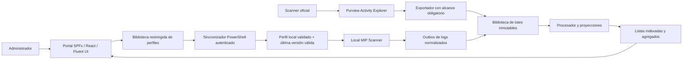

# Arquitectura propuesta

## Componentes

SharePoint aloja el portal y los datos. PowerShell y los procesos Windows ejecutan sincronización, exportación y procesamiento fuera de SharePoint: una página no puede ejecutar el scanner en una estación. SPFx es la extensión soportada para páginas modernas; no se inyectará JavaScript ni se alterará el DOM de la interfaz de Microsoft.

## Experiencia del portal

Navegación: Inicio, Scanners, Perfiles, Explorador de contenido, Explorador de actividades, Estado de ingesta y Administración. Interfaz en español, adaptable, accesible y con componentes Fluent UI. Patrones inspirados en Purview: navegación lateral, tarjetas, filtros y panel lateral de detalle. Mantener el encabezado de SharePoint y una marca propia.

Inicio muestra equipos registrados, última comunicación, cobertura del escaneo, archivos inspeccionados, archivos con hallazgos y eventos de etiquetas. Separar métricas de la última ejecución de métricas históricas y advertir cuando la cobertura sea parcial. Los exploradores filtran por periodo UTC presentado en zona del usuario, scanner, dispositivo, cuenta, regla/SIT, etiqueta y resultado. Mostrar origen, nivel de atribución, fecha de ingesta y frescura.

## Configuración oculta y descubrimiento

1. Biblioteca `ScannerPortalConfig` oculta de navegación/búsqueda donde sea configurable, con herencia rota y permisos explícitos. Versionado habilitado. Los administradores del sitio siguen pudiendo acceder.
2. Un perfil publicado es un archivo inmutable `profiles/{profileId}/{version}/profile.json`. Un puntero `assignments/{deviceGroupId}.json` indica la versión activa. Guardar borradores por separado; actualizar el puntero con ETag/If-Match evita sobrescrituras concurrentes.
3. Bootstrap no secreto por equipo: tenant ID, site ID/URL, drive ID, group/profile ID, application ID, referencia al certificado y versión mínima compatible. Entregarlo con instalador/Intune/GPO. No buscar sitios ni perfiles de forma anónima.
4. Sincronizador autenticado descarga el perfil asignado, valida esquema, compatibilidad, hash y semántica, y prepara los cinco JSON en un directorio nuevo con ACL local. El hash detecta corrupción; la autenticidad depende del canal autenticado y de los permisos de publicación. Si se requiere distribución fuera de este canal, usar firma de un manifiesto con clave de confianza independiente.
5. Resolver variables Windows bajo la identidad del proceso. Validar rutas, extensiones, límites y expresiones regulares. Los campos de perfil nunca contienen comandos PowerShell ejecutables.
6. Publicar el directorio completo y fijarlo para una ejecución mediante `-ConfigDirectory`. Guardar `profileId/version/hash` en el contexto de ejecución. Conservar última versión válida y registrar su uso; impedir modo escritura con perfil expirado o incompatible. Mantener valores por defecto seguros y permitir auditoría offline según política explícita.

Los perfiles publicados necesitan una retención compatible con rollback; no incluirlos en una limpieza automática de lotes de eventos.

## Identidades y permisos

| Identidad | Acceso previsto |
| --- | --- |
| Administrador de despliegue | Aprovisiona sitio/recursos y paquete; privilegios temporales y explícitos |
| Administrador de configuración | Edita y publica perfiles; permisos de datos independientes de ser lector del portal |
| Analista | Lee reportes y agregados; sin escritura en configuración |
| Agente local | Lee perfil asignado, entrega telemetría; sin edición de configuración |
| Exportador AE | Rol Purview necesario para exportar y escritura únicamente en su landing |
| Procesador | Lee landing, actualiza proyecciones y checkpoints |

Certificados con clave privada protegida por ACL en el almacén Windows o secretos en Azure Key Vault. El navegador nunca recibe credenciales de aplicación. Registrar tenant/client ID y thumbprint no entrega el secreto. No reutilizar la cuenta de servicio del scanner como administrador del portal.

Preferir permisos seleccionados de Graph con concesión explícita a los recursos necesarios. `Sites.Selected` restringe al sitio concedido, no garantiza por sí mismo acceso de solo lectura a configuración y escritura solo a telemetría dentro del mismo sitio. Evaluar `Lists.SelectedOperations.Selected` y las operaciones concretas de drives/listas en SP2; alternativa: sitios de configuración y telemetría separados con permisos independientes. El permiso de exportar Purview se concede aparte; Graph no lo reemplaza. Validar que un agente no pueda leer perfiles de otro grupo si se exige ese aislamiento.

## Datos y escala

`ScannerRegistry`, `ScanRuns`, `ContentFindings`, `LabelActivities`, `IngestionRuns` y `DashboardDaily` son proyecciones consultables, no archivo histórico completo. Indexar fecha, scanner, dispositivo y clave de evento; consultar con filtros y paginación server-side. En findings, una fila por archivo/regla/ejecución, sin valores sensibles encontrados. Deduplicar el conteo de archivos entre reglas.

`ScannerPortalLanding` conserva JSONL y un manifiesto por lote con checksum, recuento y rango. El procesador usa clave determinista por registro y confirma solo lotes completos. Los eventos de etiquetas de ambas fuentes se correlacionan sin eliminar evidencia original ni sumar dos veces la misma operación. La retención y eliminación abarcan originales, proyecciones, backups y exportaciones.

SharePoint es el punto de partida del piloto. Evitar consultas de listas sin índice y la carga de todos los eventos en el cliente. Medir con volumen y filtros reales; si supera objetivos, mantener SharePoint como portal/configuración y mover consulta histórica a ADX mediante API autenticada. Nunca exponer credenciales ADX al frontend. La decisión de capacidad es salida de SP4.

Referencias: [SPFx](https://learn.microsoft.com/en-us/sharepoint/dev/spfx/sharepoint-framework-overview), [permisos seleccionados](https://learn.microsoft.com/en-us/graph/permissions-selected-overview), [autenticación Key Vault](https://learn.microsoft.com/en-us/azure/key-vault/general/authentication).
